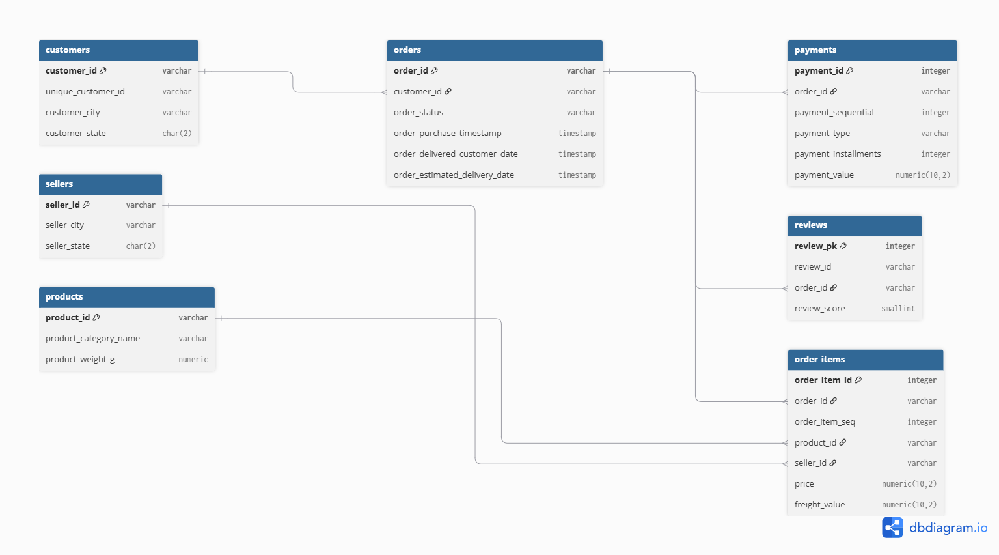

# Project 1 — E-Commerce Database Design

## Overview

A production-quality normalized relational database design for an e-commerce business, built on the real Olist Brazilian E-Commerce dataset. This project demonstrates relational modeling, SQL analysis, and database engineering skills.

**This project performs a one-time historical seed to populate the schema for design and query-analysis purposes. Ongoing and incremental data movement into this schema is handled separately in Project 2 (ETL Pipeline).**

## Tech Stack

- PostgreSQL 16 (Docker)
- Python 3 + Pandas (data exploration + seed script)
- dbdiagram.io (ERD design)
- Docker + docker-compose

## Dataset

[Olist Brazilian E-Commerce Dataset](https://www.kaggle.com/datasets/olistbr/brazilian-ecommerce) — 9 CSV files, ~100,000 orders, ~99,000 customers.

## Schema Design

Single schema: `production`. Fully normalized (3NF).

### ERD



### Tables

| Table | Rows | Description |
|---|---|---|
| customers | 99,441 | Customer records with city/state |
| sellers | 3,095 | Seller records with city/state |
| products | 32,951 | Product catalog with category and weight |
| orders | 99,441 | Order lifecycle with status and timestamps |
| order_items | 112,650 | Line items per order (price, freight) |
| payments | 103,886 | Payment records (supports split payments) |
| reviews | 99,224 | Customer reviews with scores |

For full schema rationale, see [docs/schema_explanation.md](docs/schema_explanation.md).

## Project Structure

```text
ecommerce-database-design/
├── sql/
│   ├── 01_create_tables.sql
│   ├── 02_constraints_indexes.sql
│   ├── 03_views.sql
│   └── 04_analytical_queries.sql
├── scripts/
│   └── one_time_seed.py
├── notebooks/
│   └── 01_explore_olist.ipynb
├── docs/
│   ├── ERD.png
│   └── schema_explanation.md
├── docker-compose.yml
├── requirements.txt
├── .env.example
└── README.md
```

## Setup

### Prerequisites
- Docker Desktop
- Python 3.11+

### 1. Clone the repository

```bash
git clone <repo-url>
cd ecommerce-database-design
```

### 2. Create virtual environment

```bash
python -m venv venv
venv\Scripts\Activate.ps1  # Windows PowerShell
pip install -r requirements.txt
```

### 3. Configure environment variables

```bash
cp .env.example .env
# Edit .env and set your PostgreSQL credentials
```

### 4. Start PostgreSQL

```bash
docker compose up -d
```

### 5. Create tables and constraints

Run the DDL files against the Docker container. The DDL must run **before** the seed script — `pandas.to_sql` will silently create TEXT-only columns if the tables don't already exist.

Windows PowerShell:

```powershell
Get-Content sql/01_create_tables.sql | docker exec -i ecommerce_postgres psql -U postgres -d ecommerce
Get-Content sql/02_constraints_indexes.sql | docker exec -i ecommerce_postgres psql -U postgres -d ecommerce
```

Bash equivalent:

```bash
docker exec -i ecommerce_postgres psql -U postgres -d ecommerce < sql/01_create_tables.sql
docker exec -i ecommerce_postgres psql -U postgres -d ecommerce < sql/02_constraints_indexes.sql
```

### 6. Load the Olist dataset

Download the dataset from Kaggle and place CSV files in `data/`. The seed script connects to `127.0.0.1:5433` (host port mapped to the container). It is a one-time load and is **not** idempotent — do not re-run it without clearing the tables first.

```bash
python scripts/one_time_seed.py
```

## Analytical Queries

Four SQL queries are included in `sql/04_analytical_queries.sql`:

### 1. Full Order Detail (Multi-table JOIN)
Joins customers, orders, order_items, products, and sellers to show complete order context.

### 2. Monthly Revenue Trend (CTE)
```sql
WITH monthly_revenue AS (
    SELECT
        DATE_TRUNC('month', o.order_purchase_timestamp) AS order_month,
        SUM(oi.price) AS total_revenue
    FROM production.orders o
    JOIN production.order_items oi ON o.order_id = oi.order_id
    GROUP BY DATE_TRUNC('month', o.order_purchase_timestamp)
)
SELECT
    order_month,
    total_revenue
FROM monthly_revenue
ORDER BY order_month;
```
Result: Revenue was R$267.36 in Sep 2016 and peaked at R$1,010,271.37 in Nov 2017 — the only month in the dataset that exceeded R$1M.

### 3. Top Product per Category (Window Function)
Uses `RANK() OVER (PARTITION BY product_category_name ...)` to find the best-selling product in each category.

### 4. Delivery Performance by State (Business Question)
Answers: *"Which states have the worst delivery performance vs. estimated date?"*

| State | Avg Delivery Days | Avg Delay Days |
|---|---|---|
| AL | 24.0 | -7.9 |
| SP | 8.3 | -10.1 |

São Paulo (SP) has the fastest delivery (8.3 days). All states delivered ahead of estimated dates on average (negative delay = early delivery).

## Key Design Decisions

- **Surrogate keys for order_items, payments, reviews:** Natural composite keys used as UPSERT conflict targets in Project 2; SERIAL surrogate used as stable internal PK.
- **review_id is non-unique by design:** 814 duplicate review_ids confirmed in source data — surrogate PK (`review_pk`) used instead.
- **Nullable delivery date:** Undelivered orders legitimately have no delivery timestamp.
- **3NF over denormalization:** Transactional integrity prioritized here; denormalization happens in Project 3's star schema.